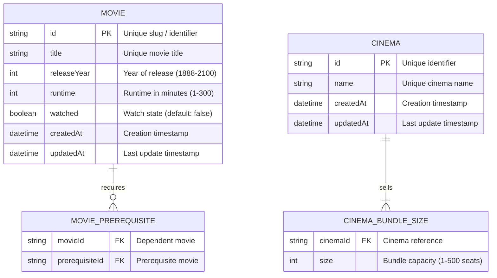
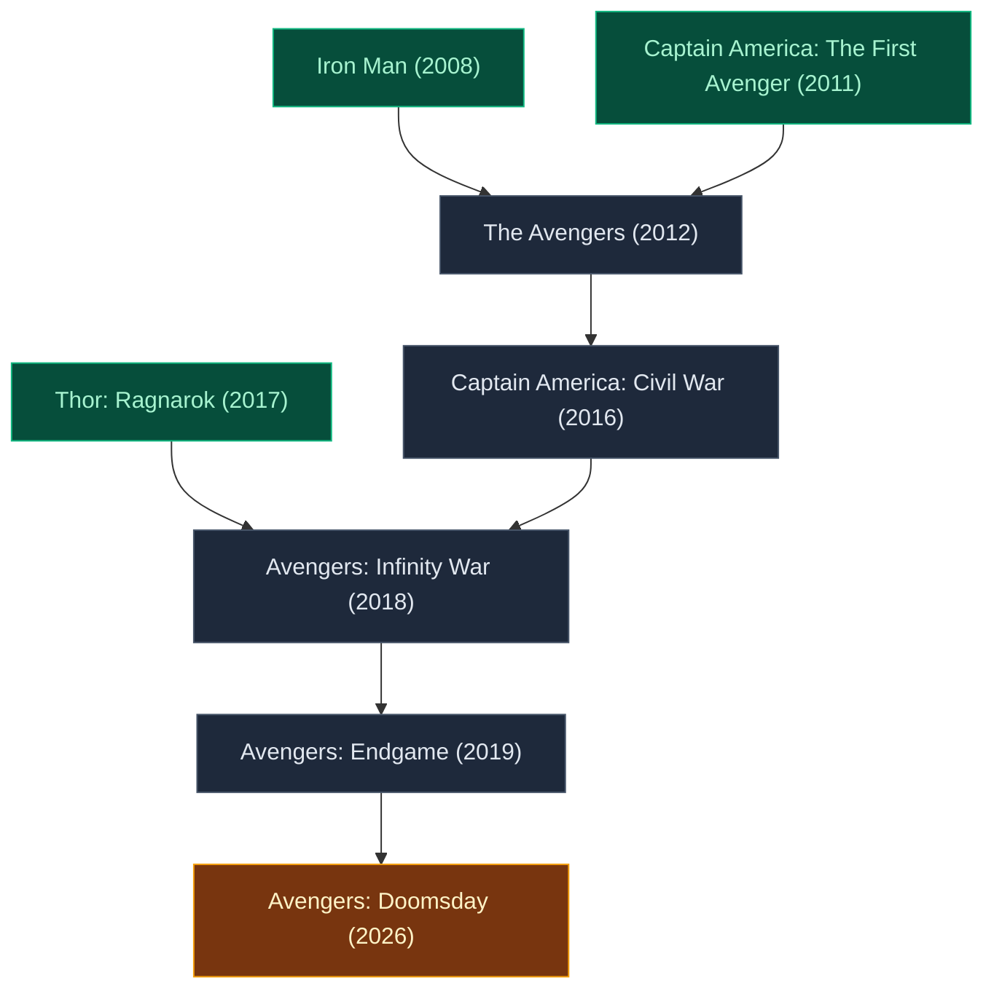

# 🛡️ Doomsday Ready — MCU Rewatch Planner & Watch-Party Optimizer

> *"There is only Doom."* — Victor Von Doom

**Doomsday Ready** is a full-stack web application designed to help Marvel Cinematic Universe (MCU) fans prepare for the premiere of ***Avengers: Doomsday***. It calculates optimal rewatch paths through the complex MCU timeline and optimizes group watch-party seat bookings for opening night.

---

## 📑 Table of Contents
1. [Key Features](#-key-features)
2. [Data Model Diagrams](#-data-model-diagrams)
3. [Algorithm Explanations (Zero External Solver Libraries)](#-algorithm-explanations)
   - [Feature 1: Cycle Detection & Topological Rewatch Order](#feature-1-cycle-detection--topological-rewatch-order)
   - [Feature 2: Dynamic Programming Watch-Party Booking](#feature-2-dynamic-programming-watch-party-booking)
4. [API Reference](#-api-reference)
5. [Tech Stack](#-tech-stack)
6. [Getting Started (One Command with Docker Compose)](#-getting-started)
7. [Running Tests](#-running-tests)
8. [AI Usage Disclosure](#-ai-usage-disclosure)
9. [Design Choices & Assumptions](#-design-choices--assumptions)

---

## 🚀 Key Features

### 🎬 Feature 1: Movies and Rewatch Order
- **Movie Catalog CRUD**: Create and update movies with unique titles, release years, runtimes (1–300 minutes), watched status, and prerequisites.
- **Cycle Prevention**: Validates dependency graphs so no movie can ever depend on itself, directly or indirectly. Any circular dependency is rejected with HTTP `409 CIRCULAR_DEPENDENCY`.
- **Topological Rewatch Planner**: Given a target movie (e.g. *Avengers: Doomsday*), returns all required movies in valid chronological order where every movie comes strictly after its prerequisites. Target itself is omitted.
- **Rewatch Analytics**: Displays watched vs. unwatched movie counts, progress percentage, and remaining unwatched watch time (in minutes, hours, and days).

### 🎟️ Feature 2: Cinemas and Watch-Party Booking
- **Cinema Venues**: Create cinemas with 1 to 10 opening-night bundle sizes (1 to 500 seats each).
- **Fewest Bundles Optimizer**: Given a group size (1 to 10,000), determines the minimum number of seat bundles that sum to **exactly** the group size, ensuring zero empty paid seats.
- **Exact Reconstruction**: Returns both the total bundles and exact count per bundle size (e.g., `4 bundles: 20 × 1, 9 × 2, 6 × 1`). If no exact combination exists, returns `"Not possible"`.

### 💻 Feature 3: Modern Next.js 15 Frontend
- Built with **Next.js 15 (App Router)**, **TypeScript**, **Tailwind CSS**, and **Framer Motion**.
- **Cinematic Theme**: Marvel Doctor Doom aesthetic featuring metallic titanium, emerald green glows (`#10b981`), arcane gold accents (`#f59e0b`), and dark vibranium slate.
- **Interactive Views**:
  1. **Movies**: Filter by watched status, edit prerequisites, toggle watched with 1-click optimistic UI, and restore canonical MCU presets.
  2. **Rewatch Plan**: Step-by-step numbered topological timeline, interactive checkboxes, animated progress bar, and celebration confetti on completion.
  3. **Booking**: Venue picker, group size stepper with preset test pills, visual bundle ticket stubs, and clear "Not possible" notifications.

---

## 📊 Data Model Diagrams

### Entity-Relationship Diagram



### Directed Acyclic Graph (DAG) for MCU Sample Data



---

## 🧠 Algorithm Explanations

Both core algorithms were written **completely from scratch without any external solver or graph libraries**, fulfilling the project rules.

### Feature 1: Cycle Detection & Topological Rewatch Order

#### 1. Cycle Detection (`wouldCauseCycle`)
- **Direct check**: If movie $M$ lists itself in `proposedPrerequisites`, a direct cycle is detected ($M \to M$).
- **Transitive check**: When $M$ proposes to depend on prerequisite $P$, we perform a Breadth-First Search (BFS) starting from $P$ following prerequisite edges in the existing graph. If traversal encounters $M$, a directed path $P \rightsquigarrow M$ already exists. Adding edge $M \to P$ would close the directed cycle ($M \to P \rightsquigarrow M$).
- **Complexity**: $O(V + E)$ where $V \le 100$ movies and $E$ is the number of prerequisite edges. Operates in $< 1\text{ ms}$.

#### 2. Transitive Ancestors & Kahn's Topological Sort (`computeRewatchOrder`)
- **Step 1 (Transitive Ancestor Extraction)**: Starting from target $T$'s direct prerequisites, traverse backwards via BFS to gather the transitive closure $S$ of all ancestral prerequisites. Target $T$ is excluded.
- **Step 2 (Topological Sorting via In-Degree Reduction)**:
  - For each movie $u \in S$, calculate its in-degree: the count of prerequisites $p \in S$ that $u$ requires before it can be watched.
  - Enqueue all nodes with `inDegree === 0` into a `readyQueue` (movies ready to watch first, e.g. *Iron Man*, *The First Avenger*, *Thor: Ragnarok*).
  - Pop movie $u$, append it to `rewatchOrder`, and for every dependent $w \in S$ that requires $u$, decrement $w$'s in-degree. When $w$'s in-degree reaches 0, enqueue $w$.
  - Tie-breaking sorts ready nodes by `releaseYear` for consistent chronological order.
- **Step 3 (Metric Aggregations)**:
  - `totalMovies`: $|S|$
  - `watchedCount`: movies where `watched === true`
  - `unwatchedCount`: movies where `watched === false`
  - `unwatchedRuntime`: sum of runtimes for unwatched movies.

---

### Feature 2: Dynamic Programming Watch-Party Booking

#### Unbounded Knapsack / Coin Change with Fewest Items (`calculateBookingQuote`)
Given bundle sizes $S = \{s_1, s_2, \dots, s_k\}$ ($k \le 10$) and group size $G$ ($1 \le G \le 10,000$):
- Let `dp[w]` be the minimum number of bundles needed to seat exactly $w$ people.
- Initialize `dp[0] = 0` and `dp[w] = Infinity` for $w \in [1, G]$.
- Maintain a pointer table `parent[w]` recording which bundle size $s$ was chosen to achieve the optimal `dp[w]`.
- **DP Recurrence**:
  $$\text{dp}[w] = \min_{s \in S, s \le w} (\text{dp}[w - s] + 1)$$
  Iterate bundle sizes descending so ties naturally prefer larger bundles.
- **Backtracking & Exact Reconstruction**:
  - If `dp[G] === Infinity`, no exact combination exists $\to$ return `possible: false, message: "Not possible"`.
  - Otherwise, backtrack from $G$ using `parent[current]` to count the quantity of each bundle size used.
- **Performance**:
  $10 \text{ bundle sizes} \times 10,000 \text{ group size} = 100,000 \text{ operations}$.
  Executes in **$< 2\text{ milliseconds}$** in Node.js.

---

## 📡 API Reference

All endpoints are hosted under `/api`.

| Method | Endpoint | Description | Status Codes |
|---|---|---|---|
| `GET` | `/` | Server welcome page & API explorer dashboard | `200` |
| `GET` | `/api/movies` | List all movies | `200` |
| `POST` | `/api/movies` | Create a movie | `201`, `400`, `409` |
| `GET` | `/api/movies/:id` | Get single movie by ID | `200`, `404` |
| `PATCH` | `/api/movies/:id` | Update movie (prerequisites, watched, title, runtime) | `200`, `400`, `404`, `409` |
| `DELETE` | `/api/movies/:id` | Delete a movie | `200`, `404` |
| `GET` | `/api/movies/:id/rewatch-order` | Calculate topological rewatch order & stats | `200`, `404` |
| `POST` | `/api/movies/seed` | Reset catalog to canonical 8 MCU challenge movies | `200` |
| `GET` | `/api/cinemas` | List all cinema venues | `200` |
| `POST` | `/api/cinemas` | Create a cinema venue with bundle sizes | `201`, `400`, `409` |
| `GET` | `/api/cinemas/:id` | Get cinema by ID | `200`, `404` |
| `GET` | `/api/cinemas/:id/booking?groupSize=X` | Calculate fewest bundles quote for group size $X$ | `200`, `400`, `404` |
| `DELETE` | `/api/cinemas/:id` | Delete a cinema venue | `200`, `404` |
| `GET` | `/api/health` | Health check endpoint | `200` |

### Sample Responses

#### `GET /api/movies/doomsday/rewatch-order`
```json
{
  "targetMovie": { "id": "doomsday", "title": "Avengers: Doomsday", "releaseYear": 2026, "runtime": 180 },
  "rewatchOrder": [
    { "id": "iron-man", "title": "Iron Man", "releaseYear": 2008, "runtime": 126, "watched": true },
    { "id": "first-avenger", "title": "Captain America: The First Avenger", "releaseYear": 2011, "runtime": 124, "watched": true },
    { "id": "ragnarok", "title": "Thor: Ragnarok", "releaseYear": 2017, "runtime": 130, "watched": true },
    { "id": "the-avengers", "title": "The Avengers", "releaseYear": 2012, "runtime": 143, "watched": false },
    { "id": "civil-war", "title": "Captain America: Civil War", "releaseYear": 2016, "runtime": 147, "watched": false },
    { "id": "infinity-war", "title": "Avengers: Infinity War", "releaseYear": 2018, "runtime": 149, "watched": false },
    { "id": "endgame", "title": "Avengers: Endgame", "releaseYear": 2019, "runtime": 181, "watched": false }
  ],
  "totalMovies": 7,
  "watchedCount": 3,
  "unwatchedCount": 4,
  "unwatchedRuntime": 620,
  "totalRuntime": 1000
}
```

#### `GET /api/cinemas/stark-imax/booking?groupSize=44`
```json
{
  "possible": true,
  "cinemaId": "stark-imax",
  "cinemaName": "Stark Tower IMAX (New York)",
  "groupSize": 44,
  "totalBundles": 4,
  "bundles": [
    { "size": 20, "quantity": 1, "totalSeats": 20 },
    { "size": 9, "quantity": 2, "totalSeats": 18 },
    { "size": 6, "quantity": 1, "totalSeats": 6 }
  ],
  "formatted": "4 bundles: 20 × 1, 9 × 2, 6 × 1"
}
```

#### `GET /api/cinemas/baxter-theater/booking?groupSize=7`
```json
{
  "possible": false,
  "message": "Not possible",
  "cinemaId": "baxter-theater",
  "cinemaName": "Baxter Plaza Cinema",
  "groupSize": 7
}
```

#### Circular Dependency Error:
```json
HTTP/1.1 409 Conflict
{
  "error": "CIRCULAR_DEPENDENCY",
  "message": "Circular dependency detected. A movie cannot depend on itself directly or indirectly."
}
```

---

## 🛠️ Tech Stack

- **Backend**: Node.js 22, Express 4, TypeScript 5, Vitest
- **Frontend**: Next.js 15, React 19, TypeScript 5, Tailwind CSS, Framer Motion, Lucide Icons, Canvas Confetti
- **DevOps**: Docker, Docker Compose

---

## ⚡ Getting Started

### Option 1: Docker Compose (Single Command)

Start both server and client together:
```bash
docker compose up --build
```
- **Frontend App**: [http://localhost:3000](http://localhost:3000)
- **Backend API**: [http://localhost:5000](http://localhost:5000)

---

### Option 2: Local Development

#### 1. Backend Server
```bash
cd server
npm install
npm run dev
```
Backend runs on port `5000`.

#### 2. Frontend Client
```bash
cd client
npm install
npm run dev
```
Frontend runs on port `3000` (and automatically proxies `/api` requests to port `5000`).

---

## 🧪 Running Tests

A comprehensive test suite of **25 unit and API integration tests** verifies all edge cases, circular dependencies, topological orderings, and dynamic programming optimizations:

```bash
cd server
npm test
```

### Verified Test Cases
- ✅ Rewatch order for *Avengers: Doomsday* returns all 7 movies in topological order
- ✅ Rewatch order for *Captain America: Civil War* returns *Iron Man* & *The First Avenger*, then *The Avengers*
- ✅ Rewatch order for *Thor: Ragnarok* returns an empty list
- ✅ Reject making *Avengers: Endgame* a prerequisite of *Iron Man* with `409 CIRCULAR_DEPENDENCY`
- ✅ Reject self-dependency with `409 CIRCULAR_DEPENDENCY`
- ✅ Bundle sizes `[1, 3, 4]` and group size `6` returns `2 bundles: 3 × 2`
- ✅ Bundle sizes `[2, 5]` and group size `11` returns `4 bundles: 5 × 1, 2 × 3`
- ✅ Bundle sizes `[6, 9, 20]` and group size `44` returns `4 bundles: 20 × 1, 9 × 2, 6 × 1`
- ✅ Bundle sizes `[4, 6]` and group size `7` returns `"Not possible"`
- ✅ Maximum group size (10,000) optimization benchmark ($< 100\text{ ms}$)

---

## 🤖 AI Usage Disclosure

In compliance with the project rules:
- **AI Tool Used**: Gemini / Google Antigravity Agent.
- **Nature of Assistance**:
  - Assisted in scaffolding boilerplate types, Tailwind CSS theme tokens, and Docker Compose configurations.

 

---

## 💡 Design Choices & Assumptions

1. **Deterministic Tie-Breaking**: When multiple movies have 0 prerequisites at the same topological level (e.g., *Iron Man* and *Captain America: The First Avenger*), they are sorted by `releaseYear` ascending. Both orders are valid topological orders; sorting by release year provides a natural, pleasant viewing experience for MCU fans.
2. **Deleting Referenced Movies**: When a movie is deleted, any references to it in other movies' prerequisite arrays are automatically cleaned up, keeping the DAG clean and valid.
3. **Optimistic UI Updates**: Ticking a movie as watched updates the client immediately and persists to the backend in the background.
4. **Preset Presets**: The UI includes instant preset buttons for all sample data test cases from the technical challenge document (`6`, `11`, `44`, `7`, `10,000`) for seamless review and evaluation.

---


